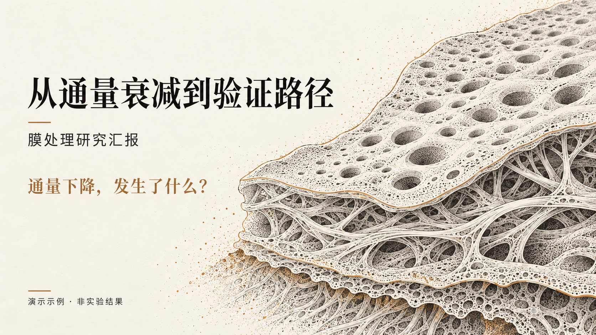
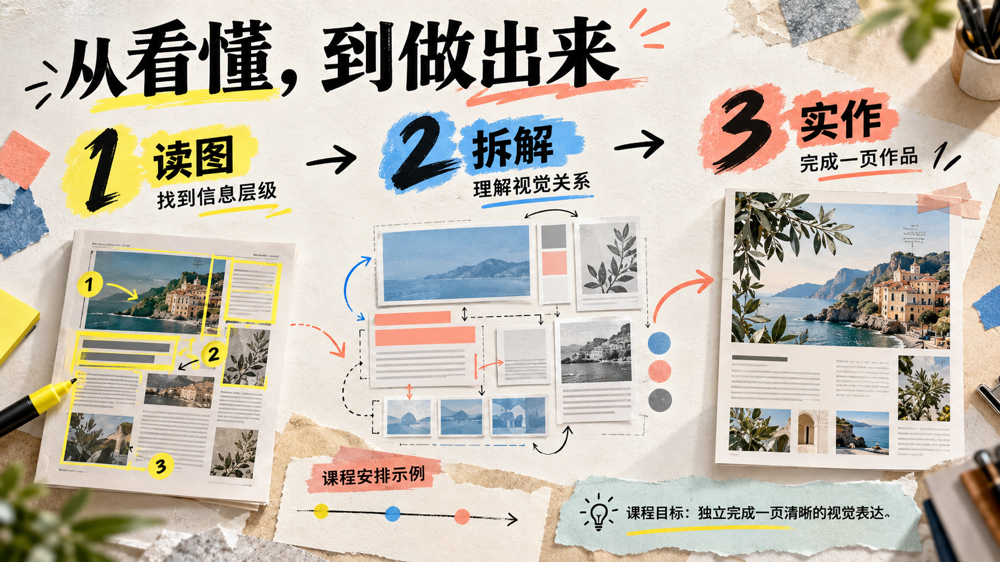
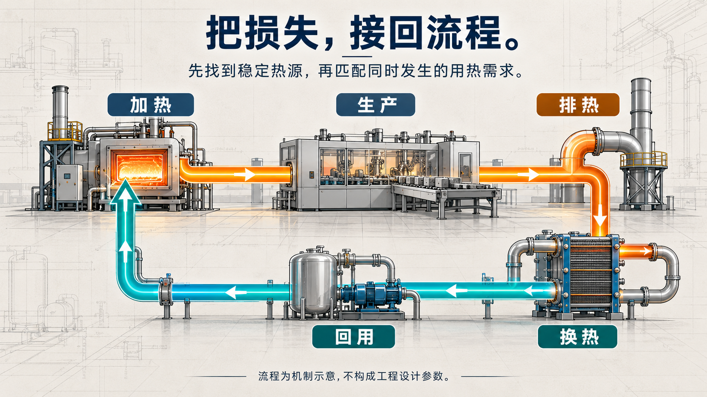
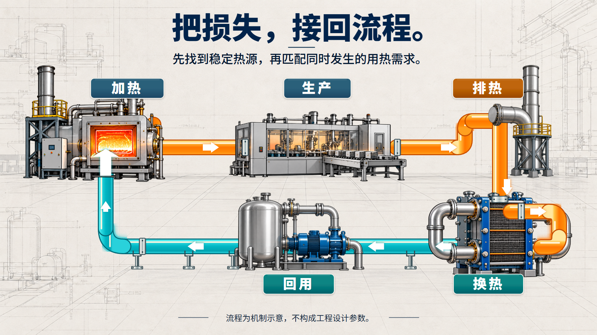

# AI Presentation Workflow

**先把内容设计好，再交付到你需要的那一步。**

完整概念图 → 按需拆独立素材 → 按需组装可编辑 PPTX。构图、配色、字体、材质和页面数随内容决定，概念设计先成立，拆件与拼装按需求选择。

[**打开在线展示**](https://pj1433139082-hue.github.io/ai-presentation-workflow/) · [六行业完整概念](https://pj1433139082-hue.github.io/ai-presentation-workflow/examples/showcase/complete/) · [竞赛与大创答辩](https://pj1433139082-hue.github.io/ai-presentation-workflow/examples/showcase/competitions/) · [从空白逐层重建](https://pj1433139082-hue.github.io/ai-presentation-workflow/examples/showcase/full-rebuild/) · [下载包](https://github.com/pj1433139082-hue/ai-presentation-workflow/releases/tag/showcase-2026-10-14)

## 不同行业，不同的表达

六套完整概念共 **29 页**。每套先组织故事线，再逐页设计。页面里的产品、项目、方案与数据为明确标注的示例。

| 科研汇报 · 6 页 | 制造业流程 · 5 页 |
| --- | --- |
|  |  |

| 科技产品 · 5 页 | 教育课程 · 4 页 |
| --- | --- |
|  |  |

| 消费品牌 · 5 页 | 公共服务 · 4 页 |
| --- | --- |
|  |  |

## 比赛与项目答辩

五套完整概念共 **31 页**。大创沿用同一虚构项目，覆盖立项、过程和结题；另有科技创新作品答辩、创新创业路演。正式备赛按实际项目与当届任务书替换内容。

| 大创立项 · 7 页 | 大创过程 · 6 页 | 大创结题 · 6 页 |
| --- | --- | --- |
|  |  |  |

[科技创新作品答辩 · 6 页](https://pj1433139082-hue.github.io/ai-presentation-workflow/examples/showcase/competitions/tech-innovation/) · [创新创业路演 · 6 页](https://pj1433139082-hue.github.io/ai-presentation-workflow/examples/showcase/competitions/entrepreneurship/)

## 三种模式，按需求结束

| 模式 | 交付内容 |
| --- | --- |
| **概念图（默认）** | 每页完整内容概念、提示词与来源记录。 |
| **概念图 + 独立素材** | 按需提供透明插画、背景底板、字形图、SVG 组件和文字源；全页素材需从空白重建验证覆盖。 |
| **概念图 + 素材 + 自动组装** | 按编辑需求使用原生文字/数据和独立图片，检查实际 PPTX 渲染及承诺的编辑操作。 |

单页风格探索不能替代整套概念。技术检查、代理视觉审阅和用户反馈分别记录。

### 三个阶段都先展示，再询问是否调整

1. **概念图完成**：展示整套概念，询问是否需要调整，等待明确回复后才制作素材。
2. **透明资产完成**：展示整批独立素材、浅深底检查；全页素材同时展示空白重建对照。询问是否调整，等待回复后才组装 PPTX。
3. **拼接完成**：展示当前 PPTX 的实际渲染、概念对照和可编辑文件，询问是否调整；确认后结束交付。

调整后回到同一阶段再展示，每阶段按整批确认。概念、素材、组装模式分别确认一次、两次、三次。代理检查或此前笼统的“继续”不代替本阶段反馈；CLI 完成状态仅表示技术就绪，对话停等由执行 agent 负责。详见[阶段反馈与停等规则](references/stage-feedback.md)。

## 从空白拼回原构图

三页样例共 **66 个独立对象**：13 张 PNG、36 个 SVG 源、17 份普通文字 JSON。背景、箭头、管线、字形、阴影反射、法兰支架、图表和说明分别保留。在线页面提供逐层开关、原尺寸查看、原图叠加与浅/深底检查。

| 原概念 | 从独立组件重建 |
| --- | --- |
|  |  |

[**查看三页完整对照**](https://pj1433139082-hue.github.io/ai-presentation-workflow/examples/showcase/full-rebuild/) · [下载素材包与 PPTX 试验](https://github.com/pj1433139082-hue/ai-presentation-workflow/releases/tag/showcase-2026-10-14)

PPTX 试验已实测保存重开、文字修改、组件移动与撤销。17 个文字框可编辑，SVG 在 PPTX 中是独立图片对象。生成式设备、字形和管线材质仍有差异，不承诺逐像素一致；未记录用户对当前 PPTX 的视觉接受，也不代表完成正式 assembly 合同。特殊标题是透明字形图，普通文字记录真实字体映射，字体软件未从栅格图恢复或嵌入。

## 局部提示词编辑

支持附实际原图，用提示词改选定对象、补干净背景、修透明边缘或补遮挡。每次保留真实输入、完整提示词、工具返回原文件与新版本，并检查目标区域及周边。事实图件与数据证据不交给生图重新编造。

[全页重建与局部编辑流程](references/full-slide-reconstruction.md) · [本地展示流程](references/showcase-workflow.md) · [技能入口](SKILL.md)

## 安装与开始

~~~bash
git clone --depth 1 https://github.com/pj1433139082-hue/ai-presentation-workflow.git
~~~

将仓库放到客户端的技能目录，例如 ~/.agents/skills/ai-presentation-workflow/。实际生图使用 Codex 内置 image_gen 与可用的 imagegen 技能；客户端、权限与后端能力需在本机检查。

> 使用 ai-presentation-workflow，基于这些资料，为【受众】设计用于【用途】的中文演示。交付选择【只做概念 / 概念加素材 / 再自动组装】。素材若需全页复用，请连背景、箭头、字形和残余装饰一起清点，并从空白重建对照。请先把概念设计好，不提前套用拼装模板。

~~~bash
python scripts/apw.py init my-presentation --mode concept
python scripts/apw.py status my-presentation
~~~

项目资料填好后按模式检查、导出。校验器检查声明结构、文件与关联，无法替代视觉判断。现有正式项目继续遵循其 G1–G5、来源与发布合同，不自动转为展示路线。

参考探索借鉴了 [awesome-gpt-image-2](https://github.com/freestylefly/awesome-gpt-image-2) 的公开案例与提示词（MIT）；逐页借鉴说明、原提示词与工具记录保留在展示目录。大体积完整交付包放在 Release，预览、项目证据、流程与检查代码保留在仓库。
